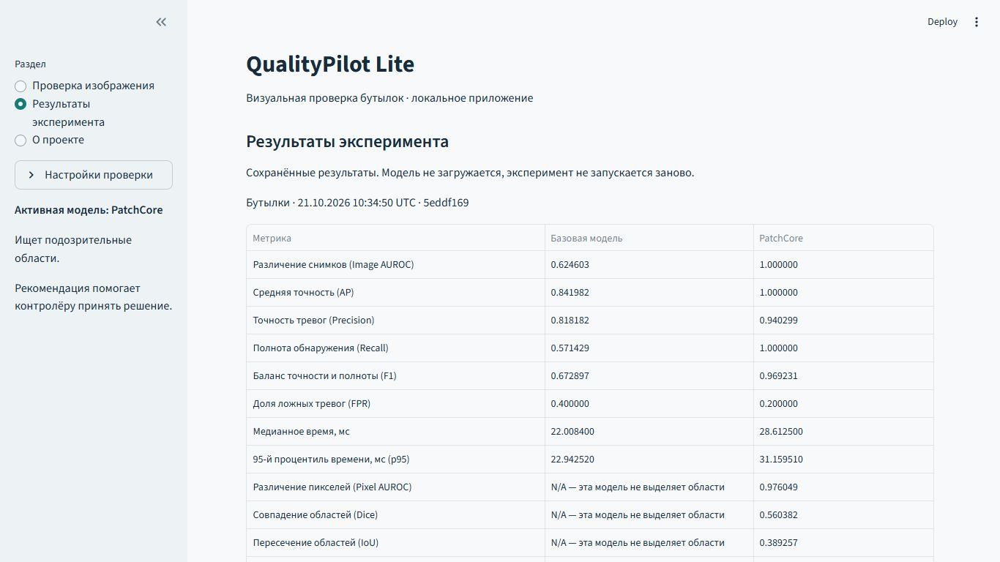
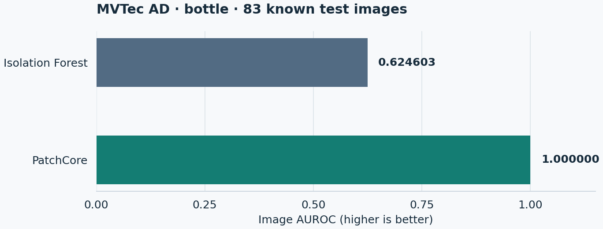
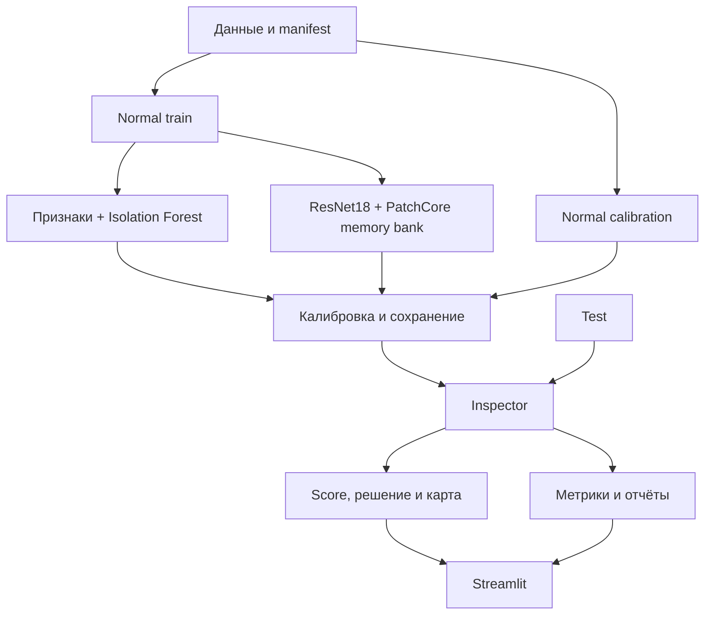

# QualityPilot Lite

[](https://github.com/FoigelVladimir/qualityPilot-Lite/actions/workflows/checks.yml)
[](pyproject.toml)
[](LICENSE)

[English](README.en.md) · [Запуск и воспроизведение](docs/reproduce.md) · [Демо за 5 минут](docs/demo.md) · [Технические отчёты](reports/README.md)

**Визуальный контроль качества: от фотографии изделия до подозрительной области и рекомендации контролёру.**

Учебный ML/CV-проект сравнивает Isolation Forest и PatchCore на MVTec AD bottle.
Локальное приложение показывает оценку аномальности, карту подозрительных областей
и рекомендацию **ACCEPT / REVIEW / REJECT**. Оценка не является вероятностью брака.



*Страница читает реальные сохранённые метрики без загрузки модели.
На публичном скриншоте нет фотографий датасета и персональных путей.*

## Результаты

**Одинаковые 83 test-изображения:** 20 исправных, 63 с дефектами.
Обучение — 167 исправных изображений, калибровка — ещё 42 исправных.
Пороги зафиксированы до оценки test; маски test для подбора порогов не использовались.

| Метрика | Isolation Forest | PatchCore |
|---|---:|---:|
| Image AUROC | 0.624603 | 1.000000 |
| Recall при одном accept | 0.571429 | 1.000000 |
| F1 при одном accept | 0.672897 | 0.969231 |
| Micro Dice, 224×224 | N/A | 0.560382 |
| Micro IoU, 224×224 | N/A | 0.389257 |

**У PatchCore остаются 4 ложные тревоги из 20 исправных снимков** при одном
фиксированном пороге; при двух порогах эти четыре снимка попадают в REVIEW.
Высокая AUROC не означает точную сегментацию: Dice/IoU показывают умеренное
совпадение областей. Baseline оценивает снимок целиком и не строит маску.



*Источник: [сопоставимый запуск Sprint 2](reports/sprint2_report.md),
`bottle-patchcore-20261021T103450Z-5eddf169`. AUROC характеризует ранжирование
снимков, а не точность границ. График не представляет новый эксперимент.*

Сравнение post-hoc: baseline test был известен при создании PatchCore.
[Повтор в чистом окружении](reports/sprint4_report.md) подтвердил воспроизводимость
на том же test, а не независимое качество на новых данных.

## Что можно сделать в приложении

- Проверить JPG/PNG локальным примером или загрузкой в память.
- Сравнить оригинал с наложением, тепловой картой, контуром или бинарной маской.
- Открыть крупный просмотр и известную разметку локального примера.
- Изменить временные пороги решения, сохранив исходные результаты эксперимента.
- Изучить метрики, матрицы ошибок и случаи FP/FN без загрузки модели.

Интерфейс на русском. Модель и устройство выбираются в «Настройках проверки»;
точные значения раскрываются отдельно. Изменение способа просмотра не запускает
повторный inference. Контур — обводка существующей маски, а не новая сегментация.

## Быстрый запуск

Проверенный маршрут: **Windows / PowerShell, Python 3.11, uv 0.9.5**.

```powershell
git clone https://github.com/FoigelVladimir/qualityPilot-Lite.git
Set-Location qualityPilot-Lite
py -m pip install uv==0.9.5
uv python install 3.11
uv sync --locked --python 3.11 --extra dev --extra ui
uv run --no-sync python -m streamlit run app.py
```

Откройте [http://127.0.0.1:8501](http://127.0.0.1:8501). Это лёгкий запуск **без Torch**:
доступны навигация, «О проекте» и объяснения отсутствующих артефактов.
Предсказания и показанные выше метрики появятся после подготовки данных и моделей;
фиктивные результаты не подставляются. Для остановки — Ctrl+C.

**Для рабочего inference:** выполните [полную установку, подготовку данных и pipeline](docs/reproduce.md).
Там же — CPU/CUDA, закреплённый источник данных, Python API и offline smoke.
Обучение и скачивание из браузера не запускаются.

## Как устроено



**Код проекта:** импорт и проверка данных, split/manifest, 60 глобальных признаков,
интеграция моделей, normal-only калибровка, общий Inspector, метрики и benchmark,
сохранение/reload, интерфейс, тесты и CI.

**Библиотеки:** Isolation Forest — scikit-learn; алгоритм PatchCore, coreset и
поиск соседей — Anomalib; backbone — предобученный ImageNet ResNet18.
Большая нейросеть с нуля не обучается.

Проект разработан с существенной помощью **OpenAI Codex**, включая генерацию кода
и технические проверки. Автор определяет направление и требования, участвует
в проверке демонстрации и изучает решения. Репозиторий не заявляется полностью
самостоятельной реализацией алгоритма; границы собственного кода описаны выше.

## Проверки и ограничения

```powershell
uv run --no-sync pytest -q
uv run --no-sync ruff check .
uv run --no-sync ruff format --check .
```

GitHub Actions проверяет baseline и UI на Windows/Ubuntu. UI job требует среду
без Torch и отсутствие пропусков UI-тестов. CI не проверяет CUDA и обучение
PatchCore; реальный checkpoint проверяется отдельным opt-in smoke.

Ограничения: одна категория, небольшой известный test, нет проверки других камер,
дрейфа и near-duplicates. Нормальная калибровка не оценивает recall дефектов.
REVIEW требует решения человека, его исход неизвестен. Это учебная система
поддержки решения, без промышленной гарантии.

## Документация и лицензии

| Что нужно | Где искать |
|---|---|
| Полный запуск, воспроизведение, API и smoke | [Руководство](docs/reproduce.md) |
| Показ приложения за 3–5 минут | [Демонстрация](docs/demo.md) |
| Данные, provenance и условия использования | [Источники данных](docs/data.md) |
| Стек и закреплённые версии | [Зависимости](docs/dependencies.md) |
| Результаты и независимые проверки | [Каталог отчётов](reports/README.md) |
| Объяснение решений и описание для резюме | [Собеседование](docs/interview.md) · [Резюме](docs/resume.md) |
| Ход работы и дальнейшие шаги | [Progress](progress.md) · [План](docs/next-sprints.md) |

Код — [MIT](LICENSE). Данные MVTec AD — **CC BY-NC-SA 4.0**, некоммерческое
использование; © MVTec Software GmbH, Bergmann et al. Лицензии зависимостей отдельные.
В измерениях использована закреплённая сторонняя копия; идентичность официальному
архиву независимо не подтверждена. Подробности — в руководстве и описании данных.
Фотографии, производные карты, модели и локальные evidence в Git не публикуются.
