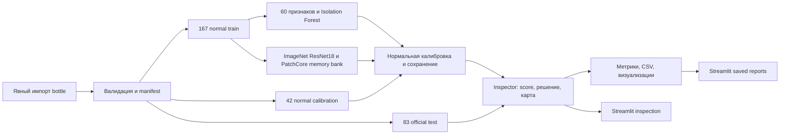

# QualityPilot Lite

[](https://github.com/FoigelVladimir/qualityPilot-Lite/actions/workflows/checks.yml)

Учебный ML/CV-проект для поиска визуальных дефектов изделий и поддержки решения
контролёра: **ACCEPT / REVIEW / REJECT**. Реализованы baseline Isolation Forest,
PatchCore через Anomalib, normal-only калибровка, оценка качества и локальный
Streamlit-интерфейс на русском языке. Anomaly score — не вероятность дефекта.

Приложение проверяет один JPG/PNG, показывает score, решение и время; для PatchCore —
heatmap, overlay и маску. Отдельная страница читает сохранённые результаты без
загрузки модели. Временные пороги меняют рекомендацию, сохраняя исходные результаты.
Данные, веса и локальные run-папки в репозиторий не входят.

## 1. Подтверждённые результаты

Сопоставимый запуск **Sprint 2**, `bottle-patchcore-20261021T103450Z-5eddf169`:
MVTec AD **bottle**, 167 normal train / 42 normal calibration / 83 official test
(20 normal, 63 defect). Параметры и пороги зафиксированы до оценки test.

| Метрика | Baseline, CPU | PatchCore, CUDA |
|---|---:|---:|
| Image AUROC | 0.624603 | 1.000000 |
| Average Precision | 0.841982 | 1.000000 |
| Precision / Recall, один accept | 0.818182 / 0.571429 | 0.940299 / 1.000000 |
| F1 / FPR, один accept | 0.672897 / 0.400000 | 0.969231 / 0.200000 |
| Confusion matrix, строки true normal/defect | `[[12,8],[27,36]]` | `[[16,4],[0,63]]` |
| REVIEW, два порога | 26 / 83 | 4 / 83 |
| Median / p95 latency, ms | 22.0084 / 22.9425 | 28.6125 / 31.1595 |
| Pixel AUROC, native 224×224 | N/A | 0.976049 |
| Micro Dice / IoU | N/A | 0.560382 / 0.389257 |

Latency: batch 1, 83 измерения, **три** calibration-image прогрева; CUDA
синхронизируется. Включены decode/preprocessing, передача, модель и решение;
загрузка весов, запись изображений и метрики исключены. RTX 3050 8 GB.
Отдельный PatchCore CPU benchmark того же run: median/p95 **48.3133/55.3131 ms**.
Исторический baseline Sprint 1 измерялся после **одного** прогрева
(median/p95 **21.03/22.09 ms**); его время не подставлено в таблицу Sprint 2.

AUROC 1.0 не отменяет **4 FP** при фиксированном accept. REVIEW означает нагрузку
на человека; результат ручной проверки неизвестен. Baseline не локализует дефекты.
Pixel metrics рассчитаны micro на сетке модели, GT уменьшена nearest-neighbour.
Это post-hoc сравнение: результаты baseline были известны при создании PatchCore.
Повтор Sprint 4 описан [отдельно](reports/sprint4_report.md), без смешивания запусков.
Подробности: [Sprint 2](reports/sprint2_report.md), [baseline Sprint 1](reports/bottle-baseline.md).

## 2. Быстрый запуск

Проверенная платформа — **Windows, PowerShell, Python 3.11.14, uv 0.9.5**.
Получите Git checkout со всеми исходниками и `uv.lock`:

```powershell
git clone https://github.com/FoigelVladimir/qualityPilot-Lite.git
Set-Location qualityPilot-Lite
```

Установка uv, если его ещё нет:

```powershell
py -m pip install uv==0.9.5
```

Из корня проекта установите лёгкий вариант без Torch:

```powershell
uv python install 3.11
uv sync --locked --python 3.11 --extra dev --extra ui
uv run --no-sync python -m streamlit run app.py
```

Откройте [http://127.0.0.1:8501](http://127.0.0.1:8501). Без данных и моделей
доступны «О проекте», upload-форма и объяснения отсутствующих артефактов.
Таблица появится после создания COMPLETE run, inference — после подготовки весов.
Фиктивные метрики и изображения не подставляются. Для остановки — Ctrl+C.
После редактирования исходников сервер нужно перезапустить.

Для полного проекта, включая PatchCore на CPU или CUDA:

```powershell
uv sync --locked --python 3.11 --extra dev --extra ml --extra ui
```

`uv run --no-sync` использует уже установленный состав extras. Обычный `uv sync`
без `--extra ml` может удалить ML-пакеты. В lock выбран PyTorch 2.8.0+cu128;
эта сборка поддерживает CPU, для CUDA нужен совместимый NVIDIA-драйвер.
Установка достаточно объёмная. [Версии и зависимости](docs/dependencies.md).
Полный pipeline с CUDA проверен на Windows. Baseline и UI проверяются отдельно
на Ubuntu/Windows в [GitHub Actions](https://github.com/FoigelVladimir/qualityPilot-Lite/actions/workflows/checks.yml);
текущий статус main показывает badge выше. CI не подтверждает CUDA и обучение
PatchCore; Linux-обучение полного pipeline локально не проверялось.

## 3. Данные и воспроизведение эксперимента

Команды ниже рассчитаны на свежую копию без моделей и run-артефактов. Интернет
нужен для установки, явного получения данных и первых ImageNet-весов.
Сохранённый checkpoint содержит backbone и memory bank и работает offline.

Данные MVTec AD: **CC BY-NC-SA 4.0**, некоммерческое использование; © MVTec
Software GmbH, Bergmann et al. Предпочтительный источник —
[официальная страница](https://www.mvtec.com/research-teaching/datasets/mvtec-ad).
Для измерений использована явно выбранная сторонняя копия
[foersben/mvtec-ad](https://huggingface.co/datasets/foersben/mvtec-ad), commit
`c75b39616f84db43677bcc8228caaafaf5096d7f`. Хеши проверяют целостность копии;
идентичность официальному архиву независимо не подтверждена.
[Получение данных, лицензия и историческая проблема ссылки](docs/data.md).

В PowerShell, после установки `dev/ml/ui`:

```powershell
# Явное согласие использовать закреплённую стороннюю копию, только bottle.
uv run --no-sync qualitypilot --config configs/bottle.yaml download-mirror
uv run --no-sync qualitypilot --config configs/bottle.yaml prepare
uv run --no-sync qualitypilot --config configs/bottle.yaml baseline
uv run --no-sync qualitypilot --config configs/patchcore.yaml patchcore
uv run --no-sync python -m streamlit run app.py
```

Вместо `download-mirror` можно импортировать полученный официальный архив:
`uv run --no-sync qualitypilot --config configs/bottle.yaml import-data .\bottle.tar.xz`.
Повторять оба способа для одной категории не нужно. `prepare` проверяет структуру,
RGB-дубликаты и маски, сохраняет manifest. `baseline` создаёт
`artifacts/bottle-baseline.joblib` и `reports/runs/bottle-baseline/`.
`patchcore` читает **этот новый baseline** через `baseline_config` и `reference_run`
в `configs/patchcore.yaml`, затем создаёт уникальный
`reports/runs/bottle-patchcore-<UTC>-<id>/` со статусом COMPLETE.

В боковой панели UI выберите **полученный COMPLETE run**, сверив имя с выводом CLI.
`configs/ui.yaml` задаёт начальный выбор; если такого имени нет, UI выбирает первый
доступный run. При нескольких запусках выберите нужный вручную. Для local-примеров
UI использует `baseline_config`; при другом конфиге baseline обновите и этот путь.

Существующие baseline-веса и результаты защищены от перезаписи. Для повторного
эксперимента нужны новые `output_dir`/`model_path`, а PatchCore должен ссылаться
на соответствующие новые baseline config и reference-run. Пути YAML разрешаются
от папки YAML; пути UI — от корня проекта. [Подробный протокол](docs/reproduce.md).
Демонстрация на 3–5 минут: [docs/demo.md](docs/demo.md).

## 4. Архитектура и Python API



Baseline: resize 128×128, 60 глобальных цветовых/текстурных признаков,
Isolation Forest, 200 деревьев. PatchCore: frozen ImageNet ResNet18, layer2/layer3,
224×224, train batch 4, coreset 1%, 9 соседей. Anomalib выполняет алгоритм PatchCore;
обучение backbone с нуля не реализовано. Обе модели используют один manifest/seed 42.

Normal-only calibration: эмпирические квантили image scores 0.95/0.99, `higher`.
`score <= accept` → ACCEPT; `accept < score <= reject` → REVIEW;
`score > reject` → REJECT. Pixel threshold — 0.99-квантиль максимумов normal maps.
Test labels/masks в подборе порогов не участвуют. Квантиль не гарантирует будущие FPR/recall.

```python
from pathlib import Path
from qualitypilot.inference.service import Inspector

# Подставьте путь к собственному доверенному артефакту из вывода CLI.
inspector = Inspector.load(Path("artifacts/bottle-baseline.joblib"), device="cpu")
result = inspector.predict(Path("data/mvtec_ad/bottle/test/broken_large/000.png"))
print(result.to_dict())
# Для PatchCore передайте model.pt; result.anomaly_map — float32 H×W.
# У baseline карта None. По умолчанию геометрия соответствует исходнику.
```

```text
app.py, .streamlit/          локальное приложение и настройки сервера
configs/                    baseline, PatchCore/reference-run и UI
src/qualitypilot/data/      импорт, mirror, структура и split
src/qualitypilot/models/    baseline и адаптер Anomalib
src/qualitypilot/decision/  калибровка и ACCEPT/REVIEW/REJECT
src/qualitypilot/inference/ Inspector, preprocessing, Prediction
src/qualitypilot/evaluation/ image/pixel metrics и matched benchmark
src/qualitypilot/experiments.py  полный PatchCore experiment
src/qualitypilot/visualization/  экспорт карт и примеров
src/qualitypilot/ui/        чтение артефактов, состояние и представление
tests/                     синтетические тесты, AppTest и opt-in smoke
docs/, reports/            инструкции и текстовые результаты
uv.lock                    закреплённые зависимости и extras
```

[Краткие ответы для собеседования](docs/interview.md).
[Формулировка проекта для резюме](docs/resume.md).

## 5. Тесты и ограничения

```powershell
uv run --no-sync pytest -q
uv run --no-sync ruff check .
uv run --no-sync ruff format --check .
uv lock --check
uv pip check
uv run --no-sync qualitypilot --help
```

Тесты и CI baseline/UI используют синтетические данные, без загрузки датасета
или pretrained-весов. UI job требует Streamlit и ноль пропусков UI-тестов.
Реальный integration smoke opt-in; без переменных окружения он явно пропущен:

```powershell
$run = Get-ChildItem reports/runs -Directory -Filter 'bottle-patchcore-*' |
    Where-Object { (Test-Path (Join-Path $_.FullName 'status.json')) -and
        ((Get-Content (Join-Path $_.FullName 'status.json') -Raw | ConvertFrom-Json).status -eq 'COMPLETE') } |
    Sort-Object Name | Select-Object -Last 1
$env:QUALITYPILOT_SMOKE_MODEL = Join-Path $run.FullName 'model.pt'
$env:QUALITYPILOT_SMOKE_IMAGE = (Resolve-Path data/mvtec_ad/bottle/test/broken_large/000.png).Path
$env:HF_HUB_OFFLINE = '1'
uv run --no-sync pytest tests/test_patchcore.py::test_real_patchcore_smoke -q
```

Ограничения: одна категория и 83 известных test-примера, без проверки других камер,
дрейфа и near-duplicates. Нормальная калибровка не оценивает пропуск дефектов.
AUROC 1.0 на этом наборе не является промышленной гарантией; Dice/IoU умеренные.
Повтор на том же известном test проверяет воспроизводимость, а не независимое качество.
Одиночное время UI не заменяет benchmark. Нет API-сервера, БД, auth или промышленного внедрения.
Принимаются только доверенные локальные checkpoints; upload весов не предусмотрен.

Код — [MIT](LICENSE), лицензии зависимостей отдельные; данные и производные
изображения — CC BY-NC-SA 4.0. Датасетные screenshots, веса, evidence и локальные
окружения исключены из поставки. Текущий статус и границы проверок:
[отчёт Sprint 4](reports/sprint4_report.md), [progress](progress.md),
[план](docs/next-sprints.md). Разработка четырёх спринтов и независимое ревью
завершены. Приложение остаётся локальным; результаты CI доступны по badge и ссылке
GitHub Actions. Промышленная готовность не заявляется.
