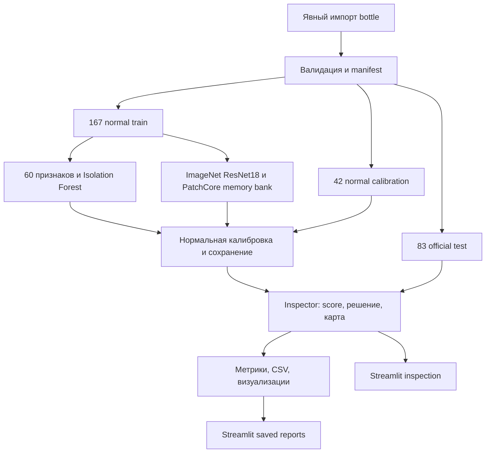

# Установка и воспроизведение QualityPilot Lite

Полный маршрут от чистого checkout до COMPLETE run. [Краткий обзор проекта](../README.md).

## Установка и запуск

Проверенная платформа — **Windows, PowerShell, Python 3.11.14, uv 0.9.5**.
Получите Git checkout со всеми исходниками и `uv.lock`:

```powershell
git clone https://github.com/FoigelVladimir/qualityPilot-Lite.git
Set-Location qualityPilot-Lite
```

Установка uv, если его ещё нет:

```powershell
py -m pip install uv==0.9.5
```

Из корня проекта установите лёгкий вариант без Torch:

```powershell
uv python install 3.11
uv sync --locked --python 3.11 --extra dev --extra ui
uv run --no-sync python -m streamlit run app.py
```

Откройте [http://127.0.0.1:8501](http://127.0.0.1:8501). Без данных и моделей
доступны «О проекте», upload-форма и объяснения отсутствующих артефактов.
Таблица появится после создания COMPLETE run, inference — после подготовки весов.
Фиктивные метрики и изображения не подставляются. Для остановки — Ctrl+C.
После редактирования исходников сервер нужно перезапустить.

На странице «Проверка изображения» выберите «Пример из датасета» или «Загрузить
фотографию» и нажмите **«Проверить изображение»** под превью. Тип примера показан
по-русски, имя фотографии сокращено. Модель, устройство и сохранённый эксперимент
находятся в боковом блоке **«Настройки проверки»**; по умолчанию — PatchCore и
автоматический выбор устройства. Читаемая подпись эксперимента содержит дату UTC
и уникальное окончание. Фактическое устройство показано после проверки.

Рекомендация содержит текст, значок и вторичный код ACCEPT/REVIEW/REJECT.
«Рекомендуется принять» не гарантирует отсутствие дефекта. Оценка показывается
с двумя знаками после запятой и **не является вероятностью дефекта**; точное
значение, сохранённые пороги, время и пути доступны в «Технических подробностях».
«Экспериментальные пороги» по умолчанию выключены, действуют временно и имеют сброс.

У PatchCore слева оригинал, справа выбранный режим; начальный — «Наложение».
Прозрачность меняет только отображение. «Крупный просмотр» раскрывает выбранное
изображение на всю ширину; доступен и штатный Fullscreen. «Сравнить с разметкой
дефекта» появляется только у локального примера с известной маской. У загрузки
разметка неизвестна; принимаются JPG/PNG до 10 МиБ и 20 млн пикселей, в памяти.
Базовая модель (Isolation Forest) оценивает снимок целиком и не выделяет области.
Контур использует прежнюю маску; отображение не улучшает качество локализации.

На странице «Результаты эксперимента» метрики, матрицы ошибок и предсказания
подписаны по-русски; определения Precision/Recall/FPR раскрываются отдельно.
Прикладной текст переведён, стандартные кнопки Streamlit (например, Browse files,
Fullscreen и меню таблицы) могут оставаться английскими. [Демонстрация](demo.md).

Для полного проекта, включая PatchCore на CPU или CUDA:

```powershell
uv sync --locked --python 3.11 --extra dev --extra ml --extra ui
```

`uv run --no-sync` использует уже установленный состав extras. Обычный `uv sync`
без `--extra ml` может удалить ML-пакеты. В lock выбран PyTorch 2.8.0+cu128;
эта сборка поддерживает CPU, для CUDA нужен совместимый NVIDIA-драйвер.
Установка достаточно объёмная. [Версии и зависимости](dependencies.md).
Полный pipeline с CUDA проверен на Windows. Baseline и UI проверяются отдельно
на Ubuntu/Windows в [GitHub Actions](https://github.com/FoigelVladimir/qualityPilot-Lite/actions/workflows/checks.yml);
текущий статус main показывает badge выше. CI не подтверждает CUDA и обучение
PatchCore; Linux-обучение полного pipeline локально не проверялось.

## Данные и воспроизведение эксперимента

Команды ниже рассчитаны на свежую копию без моделей и run-артефактов. Интернет
нужен для установки, явного получения данных и первых ImageNet-весов.
Сохранённый checkpoint содержит backbone и memory bank и работает offline.

Данные MVTec AD: **CC BY-NC-SA 4.0**, некоммерческое использование; © MVTec
Software GmbH, Bergmann et al. Предпочтительный источник —
[официальная страница](https://www.mvtec.com/research-teaching/datasets/mvtec-ad).
Для измерений использована явно выбранная сторонняя копия
[foersben/mvtec-ad](https://huggingface.co/datasets/foersben/mvtec-ad), commit
`c75b39616f84db43677bcc8228caaafaf5096d7f`. Хеши проверяют целостность копии;
идентичность официальному архиву независимо не подтверждена.
[Получение данных, лицензия и историческая проблема ссылки](data.md).

В PowerShell, после установки `dev/ml/ui`:

```powershell
# Явное согласие использовать закреплённую стороннюю копию, только bottle.
uv run --no-sync qualitypilot --config configs/bottle.yaml download-mirror
uv run --no-sync qualitypilot --config configs/bottle.yaml prepare
uv run --no-sync qualitypilot --config configs/bottle.yaml baseline
uv run --no-sync qualitypilot --config configs/patchcore.yaml patchcore
uv run --no-sync python -m streamlit run app.py
```

Вместо `download-mirror` можно импортировать полученный официальный архив:
`uv run --no-sync qualitypilot --config configs/bottle.yaml import-data .\bottle.tar.xz`.
Повторять оба способа для одной категории не нужно. `prepare` проверяет структуру,
RGB-дубликаты и маски, сохраняет manifest. `baseline` создаёт
`artifacts/bottle-baseline.joblib` и `reports/runs/bottle-baseline/`.
`patchcore` читает **этот новый baseline** через `baseline_config` и `reference_run`
в `configs/patchcore.yaml`, затем создаёт уникальный
`reports/runs/bottle-patchcore-<UTC>-<id>/` со статусом COMPLETE.

В боковой панели UI выберите **полученный COMPLETE run**, сверив имя с выводом CLI.
`configs/ui.yaml` задаёт начальный выбор; если такого имени нет, UI выбирает первый
доступный run. При нескольких запусках выберите нужный вручную. Для local-примеров
UI использует `baseline_config`; при другом конфиге baseline обновите и этот путь.

Существующие baseline-веса и результаты защищены от перезаписи. Для повторного
эксперимента нужны новые `output_dir`/`model_path`, а PatchCore должен ссылаться
на соответствующие новые baseline config и reference-run. Пути YAML разрешаются
от папки YAML; пути UI — от корня проекта. Раздел «Повтор, сохранность и сравнение» ниже описывает новые пути.
Демонстрация на 3–5 минут: [docs/demo.md](demo.md).

## Архитектура и Python API



Baseline: resize 128×128, 60 глобальных цветовых/текстурных признаков,
Isolation Forest, 200 деревьев. PatchCore: frozen ImageNet ResNet18, layer2/layer3,
224×224, train batch 4, coreset 1%, 9 соседей. Anomalib выполняет алгоритм PatchCore;
обучение backbone с нуля не реализовано. Обе модели используют один manifest/seed 42.

Normal-only calibration: эмпирические квантили image scores 0.95/0.99, `higher`.
`score <= accept` → ACCEPT; `accept < score <= reject` → REVIEW;
`score > reject` → REJECT. Pixel threshold — 0.99-квантиль максимумов normal maps.
Test labels/masks в подборе порогов не участвуют. Квантиль не гарантирует будущие FPR/recall.

```python
from pathlib import Path
from qualitypilot.inference.service import Inspector

# Подставьте путь к собственному доверенному артефакту из вывода CLI.
inspector = Inspector.load(Path("artifacts/bottle-baseline.joblib"), device="cpu")
result = inspector.predict(Path("data/mvtec_ad/bottle/test/broken_large/000.png"))
print(result.to_dict())
# Для PatchCore передайте model.pt; result.anomaly_map — float32 H×W.
# У baseline карта None. По умолчанию геометрия соответствует исходнику.
```

```text
app.py, .streamlit/          локальное приложение и настройки сервера
configs/                    baseline, PatchCore/reference-run и UI
src/qualitypilot/data/      импорт, mirror, структура и split
src/qualitypilot/models/    baseline и адаптер Anomalib
src/qualitypilot/decision/  калибровка и ACCEPT/REVIEW/REJECT
src/qualitypilot/inference/ Inspector, preprocessing, Prediction
src/qualitypilot/evaluation/ image/pixel metrics и matched benchmark
src/qualitypilot/experiments.py  полный PatchCore experiment
src/qualitypilot/visualization/  экспорт карт и примеров
src/qualitypilot/ui/        чтение артефактов, состояние и представление
tests/                     синтетические тесты, AppTest и opt-in smoke
docs/, reports/            инструкции и текстовые результаты
uv.lock                    закреплённые зависимости и extras
```

[Краткие ответы для собеседования](interview.md).
[Формулировка проекта для резюме](resume.md).

## Повтор, сохранность и сравнение

Baseline откажется перезаписать существующие model_path/metrics.json. Самый простой
повтор с неизменными конфигами — новая копия исходников без артефактов, как в Sprint 4.
При переиспользовании данных сделайте отдельные копии конфигов и измените только пути:

| Поле | Требование |
|---|---|
| baseline data_root | существующая проверенная bottle |
| baseline output_dir | новая пустая папка |
| baseline model_path | новый отсутствующий .joblib |
| PatchCore baseline_config | путь к этому новому baseline YAML |
| PatchCore reference_run | тот же новый baseline output_dir |
| PatchCore output_root | папка для новых уникальных PatchCore runs |
| UI baseline_config | новый YAML внутри корня проекта |
| UI runs_root / selected_run | папка и имя полученного COMPLETE run |

Не меняйте seed, split fraction, признаки, размеры, backbone/layers, coreset,
neighbours, quantiles или warmup ради совпадения результатов. Все пути YAML
разрешаются от **папки файла конфигурации**, кроме UI-путей от корня проекта.
Сверяйте manifest SHA256, paths/labels, calibration scores/thresholds, test scores,
decisions и image/pixel metrics. Время зависит от нагрузки/кэша; checkpoint хранит
metadata с путями и окружением, поэтому его байтовый SHA256 между запусками
не является критерием равенства модели. Старые checkpoint проверяются по SHA256
только для доказательства, что они не изменены.

Test уже известен: повтор проверяет воспроизводимость подготовки, а не создаёт
независимый benchmark. При отклонениях сохраните оба набора результатов и опишите
их; не подбирайте параметры. Если доступны только inference и reload, нельзя
объявлять подтверждённым обучение memory bank с нуля.

## Тесты и offline inference

```powershell
uv run --no-sync pytest -q
uv run --no-sync ruff check .
uv run --no-sync ruff format --check .
uv lock --check
uv pip check
uv run --no-sync qualitypilot --help
```

Тесты и CI baseline/UI используют синтетические данные, без загрузки датасета
или pretrained-весов. UI job требует Streamlit и ноль пропусков UI-тестов.
Реальный integration smoke opt-in; без переменных окружения он явно пропущен:

```powershell
$run = Get-ChildItem reports/runs -Directory -Filter 'bottle-patchcore-*' |
    Where-Object { (Test-Path (Join-Path $_.FullName 'status.json')) -and
        ((Get-Content (Join-Path $_.FullName 'status.json') -Raw | ConvertFrom-Json).status -eq 'COMPLETE') } |
    Sort-Object Name | Select-Object -Last 1
$env:QUALITYPILOT_SMOKE_MODEL = Join-Path $run.FullName 'model.pt'
$env:QUALITYPILOT_SMOKE_IMAGE = (Resolve-Path data/mvtec_ad/bottle/test/broken_large/000.png).Path
$env:HF_HUB_OFFLINE = '1'
uv run --no-sync pytest tests/test_patchcore.py::test_real_patchcore_smoke -q
```

Сохранённый model.pt содержит backbone и memory bank. Offline относится к inference
уже подготовленной модели, а не к установке зависимостей. CI использует синтетические
данные и не подтверждает обучение PatchCore или CUDA. Полный pipeline с CUDA проверен
на Windows; Linux-обучение отдельно не подтверждено.
